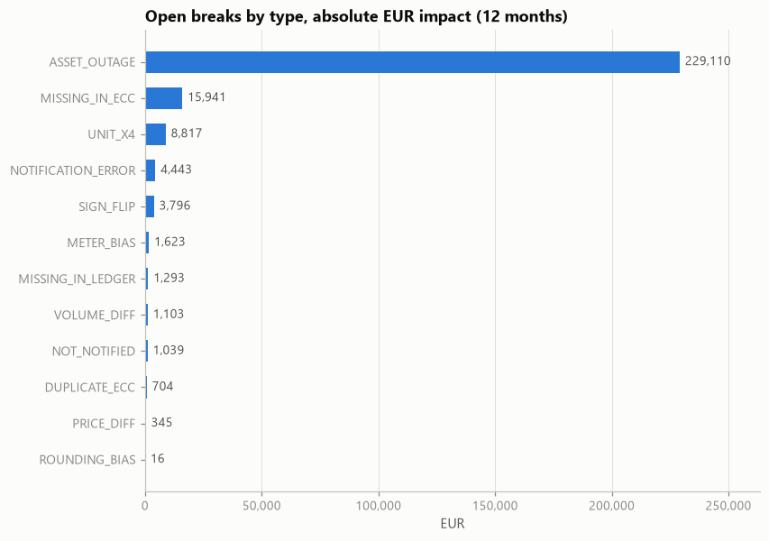
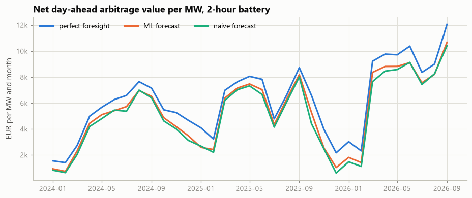
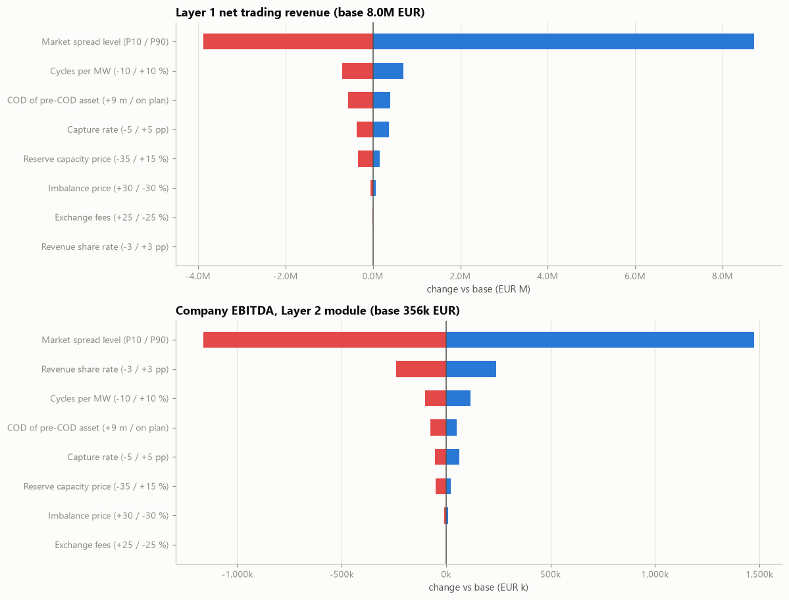
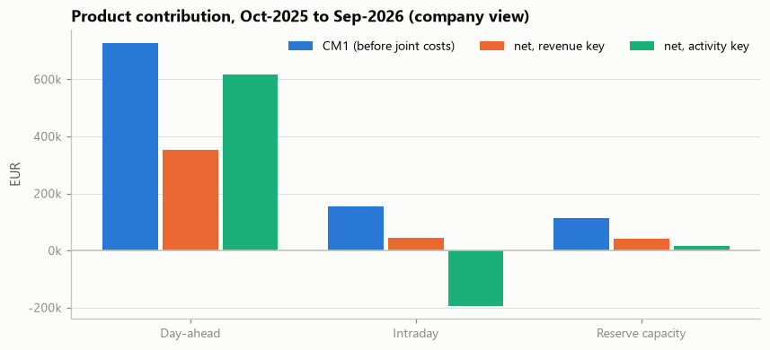

# Battery flexibility trading: a controller's toolkit

A self-built case study on the controlling side of battery flexibility trading, using real German day-ahead prices
(2019 to Oct 2026). It answers the questions a controller in this business deals with every month:

1. Do our MWh and euros agree with the exchange, interval by interval?
2. Why did we miss the forecast?
3. What happens in a bad year?
4. Which product actually earns money?

Everything runs end to end, from the raw data pull to an Excel model with built-in checks.
**Full walkthrough with code and outputs:** [notebooks/flex_controlling_case.ipynb](notebooks/flex_controlling_case.ipynb)

## Results at a glance

| Area | Result |
|---|---|
| Data audit | 273,500 price intervals since 2019, all 15 DST days complete. A widely used alternative file was rejected after testing: no negative prices, two series mixed. |
| Forecast | Walk-forward gradient boosting: MAE 24.2 vs 29.6 EUR/MWh for the naive benchmark. Worth about 2.2-2.9k EUR per MW and year in captured spread. |
| Reconciliation | 23,274 intervals / 16.6M EUR over 12 months, 99.3 % within tolerance. Every injected break type found, plus a systematic truncation and a 0.3 % meter bias that no single interval reveals. |
| Variance | Exact price-volume-mix bridge. One-month-ahead errors are 62 % market spread; the flat reserve-price assumption is biased in 16 of 21 months. |
| Scenarios | 12-month net trading revenue: stress 2.9M / base 8.0M / upside 10.5M EUR. Revenues are right-skewed, so the normal approximation overstates downside risk. |
| Profitability | Intraday looks loss-making under one allocation key and profitable under the other. Dropping it would cut company result by 153k EUR. |

## What is real, what is synthetic

| Element | Status |
|---|---|
| DE-LU day-ahead prices, load, residual load, wind, solar | **real**: Energy-Charts API (Fraunhofer ISE), data Bundesnetzagentur / SMARD, CC BY 4.0 |
| Battery dispatch (perfect foresight, ML forecast, naive forecast) | **computed** from real prices (linear programme per local delivery day) |
| Assets, contracts, trading ledger, exchange statements, schedules (Fahrplan), meters | **synthetic**, with injected breaks and a ground-truth log, so the reconciliation can be scored |
| Reserve capacity prices, intraday value, imbalance price (reBAP) | **modelled**; every parameter is declared once in `src/fcc/config.py` with a provenance label |

Nothing here describes a real company. Non-goals: accounting treatment, tax, project finance, margining.

## Highlights

**Reconciliation.** Every 15-minute interval is matched across four records: trading ledger, exchange statement
(local clock time, with A/B markers for the repeated DST hour), schedule notified to the TSO, and meter. All
arithmetic runs in UTC, because a German delivery day has 92, 96 or 100 quarter-hours. Breaks are classified by
signature (MW vs MWh factor 4, sign flip, duplicate, missing, price correction) and collected in a break register.



**Forecast, judged in euros.** The same battery is dispatched with perfect foresight, with the ML forecast and with
a naive forecast. The gap between the lines is what a better forecast is worth.



**Scenarios.** Market spread dominates. For company EBITDA, the revenue-share rate comes second: a commercial lever,
not a market one.



**Product profitability.** The allocation key decides the verdict for intraday. The total is identical under both
keys: allocation moves profit between products, it does not create it.



## Excel deliverable

[outputs/flex_controlling_case.xlsx](outputs/flex_controlling_case.xlsx): Checks (12 tests + master flag) | README |
Inputs | Monthly_Actuals | Bridge (live PVM formulas) | Interval_Count | Recon_Daily | Break_Register | Scenarios |
Product_PnL (allocation-key drop-down) | Change_Log. Verified by full recalculation in Excel (all checks OK) and by a
negative test (a wrong sign and a broken allocation key flip the master flag to ERROR).

## Layout

```
data/energy_charts/   price_de_lu.parquet, fundamentals_de.parquet (pulled by src/fetch_data.py)
data/raw/             third-party file, kept only for the data audit in section 1.1
src/fetch_data.py     resumable pull from the Energy-Charts API (rate-limit aware, cached per chunk)
src/fcc/              config (assumptions registry) | market | forecast | dispatch | portfolio | synth | recon |
                      variance | scenarios | contracts | profitability | excel_out | viz
notebooks/            flex_controlling_case.ipynb (executed, with outputs)
tools/                build_notebook.py + narrative.md (the notebook is generated from these)
outputs/              Excel workbook, sample raw CSVs
```

## Run

```
uv venv .venv && uv pip install --python .venv/Scripts/python.exe -r requirements.txt
.venv/Scripts/python.exe -P src/fetch_data.py data/energy_charts 2019-01-01 2026-10-19   # optional: data is included
.venv/Scripts/python.exe -P tools/build_notebook.py --execute                            # about 5 minutes on first run
```

The first run computes the dispatch from 2019 onwards and the walk-forward forecast, and caches them in
`outputs/cache`. Results are deterministic (fixed seeds).

## Licences and attribution

Price and system data: Bundesnetzagentur | SMARD.de via Energy-Charts (Fraunhofer ISE), CC BY 4.0.
Audit file `data/raw`: Elpriser / Hugging Face "germany-power-market" (source ENTSO-E), CC BY 4.0.

Author: Mehmet Ardil Altuncu · [LinkedIn](https://www.linkedin.com/in/mehmetardilaltuncu/)
